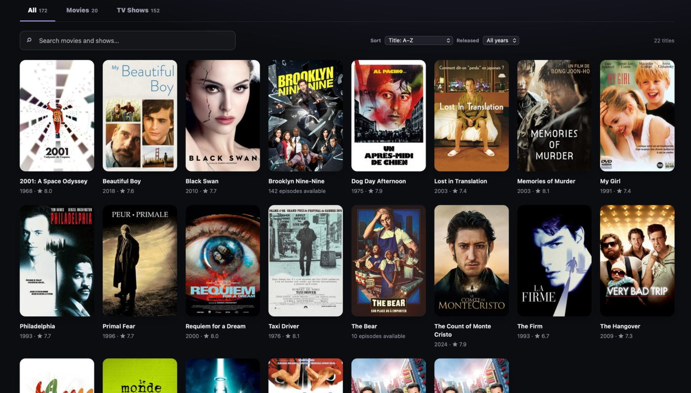

<div align="center">

# IINA Library

**Your movies and TV shows. Beautifully organized. Powered by IINA.**

An open-source media library plugin for [IINA](https://iina.io/) on macOS. Browse your local collection through a clean, native-feeling interface, discover movie and episode details, and pick up exactly where you left off — with IINA handling playback.

   

[Installation](#installation) · [Features](#features) · [Getting started](#getting-started) · [FAQ](#faq) · [Report an issue](https://github.com/monroedb/IINA-library/issues)

</div>



## Why IINA Library?

[IINA](https://iina.io/) is a powerful macOS video player, but browsing a collection of local movies and shows often means searching through folders. **IINA Library brings your entire collection into one visual home** while keeping the native IINA player — including its subtitle, audio, and playback controls.

No Plex or Jellyfin server. No media uploads. No subscription.

## Features

- **Visual library** — automatically discover movies and series in folders you select, including nested folders.
- **Movie and TV metadata** — fetch posters, descriptions, release dates, ratings, and episode information from [TMDB](https://www.themoviedb.org/).
- **Smart identification** — recognize titles from filenames or parent folders, and correct inaccurate matches manually.
- **Organized TV shows** — group episodes by show and season, with episode titles when available.
- **Continue Watching** — automatically save progress and resume movies or individual episodes after closing and reopening IINA.
- **Fast browsing** — search, filter by release decade, and sort by title, year, or rating.
- **Native playback** — play directly in IINA with its full subtitle, audio, and video settings.
- **Local-first** — keep your library preferences, watch progress, and cached artwork on your Mac.
- **macOS design** — dark appearance, San Francisco system font, and a minimal interface.

## Requirements

- macOS with **IINA 1.4 or later** (the latest stable version is recommended).
- Movie and/or TV files in folders accessible to IINA.
- An internet connection for initial TMDB lookups.
- A free personal **TMDB API v3 key** for artwork and metadata: [Get your key](https://www.themoviedb.org/settings/api).

> **Note:** IINA Library is an independent community project. It is not developed, sponsored, or endorsed by the IINA team.

## Installation

### Install from GitHub (recommended)

1. Install or update [IINA](https://iina.io/).
2. Open **IINA → Settings → Plugins**.
3. Choose **Install from GitHub…**.
4. Enter the repository URL:

   ```text
   https://github.com/monroedb/IINA-library
   ```

5. Confirm the requested permissions and install the plugin. Restart IINA if prompted.

GitHub-based installation enables IINA to check for plugin updates.

### Manual installation

If installing from GitHub is unavailable, use a packaged `.iinaplgz` file if one is provided in [Releases](https://github.com/monroedb/IINA-library/releases). A developer can also install the plugin as a `.iinaplugin` folder in:

```text
~/Library/Application Support/com.colliderli.iina/plugins/
```

Avoid keeping multiple installed copies of IINA Library with the same plugin identifier.

## Getting started

1. Launch **IINA Library** from IINA.
2. Click **Add folder** and select the parent folder containing your movies and TV shows. For example, selecting `Media/` can discover both `Media/films/` and `Media/series/`.
3. Open **Settings & advanced tools → TMDB metadata**.
4. Enter and save your personal **TMDB API v3 key**.
5. Click **Refresh metadata & artwork** to fetch information and posters.
6. Click an **image or title** to see details, edit the TMDB match, or reveal the file in Finder. Click the **Play** button on the poster to start playback immediately.
7. When you stop watching, use **Continue Watching → Resume** to pick up where you left off.

Your manually selected TMDB matches and local edits are preserved when the library is scanned again.

## FAQ

<details>
<summary><strong>Do I need Plex, Jellyfin, or a server?</strong></summary>

No. IINA Library reads the folders you select on your Mac and uses IINA for playback.

</details>

<details>
<summary><strong>Does every user need a TMDB API key?</strong></summary>

Yes. TMDB access is free for qualifying non-commercial use, subject to TMDB's terms. Each user enters their own key locally; there is no shared key embedded in this repository.

</details>

<details>
<summary><strong>Does it work with iCloud Drive?</strong></summary>

The library can discover some files represented by iCloud placeholders. A movie must be available locally before IINA can play it. Download it in Finder if necessary.

</details>

<details>
<summary><strong>Can I fix a wrong poster or title?</strong></summary>

Yes. Open the title's detail page, choose **Edit metadata**, search TMDB for the correct match, or enter a custom title, year, and description.

</details>

<details>
<summary><strong>Does it change or move my video files?</strong></summary>

No. The plugin indexes files, manages its own local metadata, and asks IINA to play the selected video. Editing metadata in the library does not rename the video file.

</details>

<details>
<summary><strong>Is it compatible with every Mac and media layout?</strong></summary>

Not yet verified. The current release is a **public beta** primarily tested with local folders on macOS. Feedback from different IINA versions, Apple Silicon/Intel Macs, external drives, and network shares is welcome.

</details>

## Privacy & local data

IINA Library does **not upload your video files** or require a project account. When requesting metadata, it sends search terms and your supplied API key to `api.themoviedb.org`; images are retrieved from `image.tmdb.org`.

Folders, API settings, artwork, manually corrected metadata, and playback progress are saved in the plugin's local data directory. Your **TMDB key is stored locally as plaintext**, not in the macOS Keychain, so do not share plugin data files or logs containing credentials.

TMDB metadata and artwork use a **180-day expiration policy**, after which they can be downloaded again. Local customizations and playback progress are kept separately.

## Contributing

Bug reports, feature suggestions, and pull requests are welcome!

- [Open an issue](https://github.com/monroedb/IINA-library/issues) for a bug or improvement request.
- When reporting a bug, include your macOS version, IINA version, reproduction steps, and relevant non-sensitive logs.
- Never post your TMDB API key, personal folder paths, or private media information.
- See the [release checklist](RELEASE_CHECKLIST.md) and [changelog](CHANGELOG.md).

## Credits & acknowledgements

- [IINA](https://iina.io/) — the open-source macOS video player used for playback.
- [The Movie Database (TMDB)](https://www.themoviedb.org/) — movie and television metadata and artwork.

**This product uses the TMDB API but is not endorsed or certified by TMDB.**

The plugin displays an [official unmodified TMDB logo](https://www.themoviedb.org/about/logos-attribution) in **Settings & advanced tools → About & Credits**. The logo is loaded from TMDB’s website and requires an internet connection; attribution text remains visible offline.

IINA Library is an independent, unofficial community plugin and is not affiliated with or endorsed by the IINA project. IINA and TMDB names, logos, and media artwork belong to their respective owners. The source-code license below does not cover third-party media or trademarks.

## License

Source code is released under the [MIT License](LICENSE). © 2026 monroedb.
